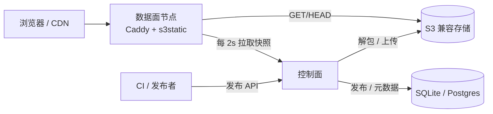

# PageForge 架构设计文档

| 项目 | 内容 |
|---|---|
| 文档版本 | v1.1（评审修订） |
| 状态 | 定稿，作为编码输入 |
| 目标读者 | 后端、测试、AI 编码代理 |
| 需求文档 | `docs/requirements.md` |

## 1. 设计目标与约束

### 1.1 目标

- 以 Caddy v2 为 HTTP 底座，自定义 handler 完成 S3 静态资源托管。
- 控制面负责 alias/project/version/binding/发布；数据面只读 snapshot。
- manifest 服务端生成、分片、不可变。
- 单节点 SQLite 起步，多节点 Postgres + snapshot 扩展。
- 默认 HTTP `:80`，不自动 HTTPS。
- 单租户，多节点分担流量。

### 1.2 关键约束

1. 不为每个 binding 生成 Caddy route，发布不触发 Caddy 配置重载。
2. manifest 不由上传者提供，服务端以实际对象为准生成。
3. 发布产物解包为独立对象，zip 仅归档。
4. bucket 私有，数据面使用 alias 凭证签名。
5. 密钥不进 snapshot、不进日志。
6. 路径规范化与 S3 key 构造集中在一个模块。
7. 切版本 10 秒内生效，允许短暂新旧混合。

## 2. 技术栈

| 层 | 选型 | 说明 |
|---|---|---|
| HTTP 数据面 | Caddy v2.11.9 + Go 自定义模块 | 复用 TLS、HTTP/2、日志、压缩、Range、条件请求 |
| 语言 | Go 1.26（`C:\Program Files\Go`，本机 go1.26.10） | 单二进制、部署简单 |
| 控制面 HTTP | `net/http` + `chi/v5` | 轻量路由 |
| 数据库 | SQLite（默认）/ Postgres（多节点） | `database/sql`，SQLite 用 `modernc.org/sqlite` |
| S3 客户端 | `minio-go/v7` | S3 兼容端点、path-style、SigV4、分段上传 |
| 配置 | YAML + 环境变量 | 控制面 YAML，数据面 Caddyfile |
| 日志 | `log/slog` JSON | 结构化 |
| 指标 | Prometheus client | `/metrics` |
| ID | ULID | `prj_`、`ver_`、`bnd_`、`dep_` |
| 加密 | AES-256-GCM | alias secret、Basic 密码哈希（bcrypt） |
| 测试 | `testing` + MinIO 容器 | 单元 + 集成 + E2E |

## 3. 系统架构



### 3.1 控制面

职责：

- alias、project、version、binding、deployment、auth policy 的 CRUD。
- 接收发布包，解包，上传对象，生成 manifest。
- 维护 `current_version_id`，提供回滚。
- 生成 snapshot，供数据面轮询。
- 审计、指标、GC。

控制面不处理终端用户的静态资源请求。

### 3.2 数据面

职责：

- 监听 `:80`，单个 catch-all handler。
- 轮询 snapshot，维护内存路由表。
- 解析 host + path → binding → project → version。
- 读取 manifest，执行 try_files。
- 本地磁盘缓存、S3 回源、HTTP 语义。
- binding 鉴权。
- 指标与访问日志。

数据面无状态，可水平扩展。除本地缓存外不写任何持久数据。

## 4. 部署形态

### 4.1 单节点

```text
pageforge-control (SQLite)  <--- HTTP snapshot --->  pageforge-proxy (Caddy)
        |                                              |
        +-------- 发布：直接写 S3 ----------------------+
```

适用：小规模、开发、单机生产。控制面与数据面可以同机。

### 4.2 多节点

```text
                    +-------------------+
CI / Admin  ------->|  pageforge-control    |<--- Postgres
                    |  (snapshot API)   |
                    +---------+---------+
                              |
              +---------------+---------------+
              |               |               |
        pageforge-proxy-1   pageforge-proxy-2   pageforge-proxy-N
              |               |               |
              +-------- S3 bucket -------------+
```

- 控制面是唯一写入口。
- 数据面每 2s 轮询 snapshot，失败保留最后可用版本。
- 数据面之间不通信。

## 5. 代码仓库结构

```text
.
├── cmd/
│   ├── control/main.go          # 控制面入口
│   └── proxy/main.go            # Caddy 自定义构建入口
├── caddy/
│   └── module.go                # http.handlers.s3static 模块注册
├── internal/
│   ├── alias/                   # alias 领域与凭证解析
│   ├── project/                 # project 领域
│   ├── version/                 # 版本状态机与指针
│   ├── binding/                 # binding 领域与冲突校验
│   ├── deploy/                  # 发布任务、解包、校验
│   ├── manifest/                # manifest 生成、分片、读取
│   ├── objectstore/             # S3 抽象与 minio-go 实现
│   ├── router/                  # host + path 匹配
│   ├── snapshot/                # 快照生成、轮询、原子替换
│   ├── handler/                 # 请求生命周期、try_files
│   ├── cache/                   # 本地对象缓存（目录镜像对象存储，空闲 TTL + LRU）
│   ├── auth/                    # binding 鉴权
│   ├── store/                   # 数据库访问与迁移
│   ├── api/                     # 管理 API
│   ├── internalapi/             # snapshot / 凭证内部 API
│   ├── gc/                      # 清理任务
│   └── observability/           # 日志、指标
├── migrations/                  # SQL 迁移
├── docs/
│   ├── requirements.md
│   └── architecture.md
└── testdata/
```

依赖方向：

```text
api/internalapi -> domain -> store
deploy -> manifest -> objectstore
handler -> router + snapshot + manifest + cache + auth + objectstore
```

禁止 `handler` 反向依赖 `api` 或 `store`。

## 6. 核心类型与接口

以下接口作为 AI 编码的契约，实现时可调整字段，但不得改变语义。

### 6.1 领域类型

```go
type Alias struct {
    ID              string
    Name            string
    Endpoint        string
    Region          string
    AccessKey       string
    SecretCipher    []byte
    PathStyle       bool
    BucketAllowlist []string
    TLSSkipVerify   bool
    CredentialVer   int64
    CreatedAt       time.Time
    UpdatedAt       time.Time
}

// HeaderRule（FR-21）：响应头规则，类似 nginx add_header。
// 挂载点：binding 级为主（对应 nginx location），project 级作为默认（对应 server）。
type HeaderRule struct {
    Name    string `json:"name"`
    Value   string `json:"value"`
    Replace bool   `json:"replace"` // true 覆盖同名头，false 追加
}

// SPAConfig 二期不新增字段；exclude_extensions 为空时使用内置默认列表（见 11.2）。
type SPAConfig struct {
    Enabled           bool     `json:"enabled"`
    ExcludePrefixes   []string `json:"exclude_prefixes,omitempty"`
    ExcludeExtensions []string `json:"exclude_extensions,omitempty"`
}

// CachePolicy 为 project 级缓存策略，字段为空时使用系统默认值。
type CachePolicy struct {
    HTML               string `json:"html"`                            // 默认 no-cache
    Assets             string `json:"assets"`                          // 默认 public, max-age=300
    AssetsImmutableGlob string `json:"assets_immutable_glob,omitempty"` // 匹配则使用 immutable，如 "assets/**"
    ImmutableMaxAge    int    `json:"immutable_max_age,omitempty"`      // 默认 31536000
    NotFoundTTLSeconds int    `json:"not_found_ttl_seconds,omitempty"`  // 默认 30
}

type Project struct {
    ID                  string
    Name                string
    AliasID             string
    Bucket              string
    CurrentVersionID    string
    IndexDoc            string
    ErrorDoc            string
    TryFilesEnabled     bool
    SPA                 SPAConfig
    Cache               CachePolicy
    PackageRetention    bool
    ResponseHeaders     []HeaderRule // 二期预留（默认层）：先应用，binding 规则后应用
    Status              string
}

type Version struct {
    ID              string
    ProjectID       string
    DeploymentID    string
    Label           string
    Status          VersionStatus
    ManifestPrefix  string
    ManifestSHA256  string
    FileCount       int64
    TotalBytes      int64
    ErrorMessage    string
    CreatedAt       time.Time
    ReadyAt         *time.Time
    PublishedAt     *time.Time
}

type Binding struct {
    ID              string
    Host            string
    PathPrefix      string
    ProjectID       string
    PinnedVersionID string
    AuthPolicyID    string
    ResponseHeaders []HeaderRule // 响应头规则（FR-21 主挂载点）：后应用，覆盖 project 默认
    Enabled         bool
}
```

### 6.2 路由

```go
type Match struct {
    Binding   Binding
    Project   Project
    Remainder string // 不带前导斜杠；根路径为空
}

type Router interface {
    Match(host, requestPath string) (Match, bool)
    Replace(s *Snapshot)
}
```

匹配实现使用：

- `map[string]*hostRoute` 精确 host；
- 按后缀长度排序的 wildcard 列表；
- 默认 host `*`；
- 每个 host 下一棵按路径段组织的 trie，节点保存 binding。

### 6.3 Snapshot

```go
type Snapshot struct {
    Generation   uint64                  `json:"generation"`
    PublishedAt  time.Time               `json:"published_at"`
    Aliases      map[string]AliasView    `json:"aliases"`
    Projects     map[string]ProjectView  `json:"projects"`
    Bindings     []BindingView           `json:"bindings"`
    AuthPolicies map[string]AuthPolicyView `json:"auth_policies"`
}

type AliasView struct {
    Endpoint      string   `json:"endpoint"`
    Region        string   `json:"region"`
    PathStyle     bool     `json:"path_style"`
    BucketAllow   []string `json:"bucket_allowlist"`
    CredentialVer int64    `json:"credential_version"`
}

// ProjectView 是 snapshot 中数据面可见的 project 字段集合。
type ProjectView struct {
    AliasID         string       `json:"alias_id"`
    Bucket          string       `json:"bucket"`
    CurrentVersionID string      `json:"current_version_id"`
    IndexDoc        string       `json:"index_doc"`
    ErrorDoc        string       `json:"error_doc"`
    TryFilesEnabled bool         `json:"try_files_enabled"`
    SPA             SPAConfig    `json:"spa"`
    Cache           CachePolicy  `json:"cache"`
    ResponseHeaders []HeaderRule `json:"response_headers"`
    Status          string       `json:"status"` // active | disabled
}

// BindingView 是 snapshot 中数据面可见的 binding 字段集合，不含软删除记录。
type BindingView struct {
    ID              string       `json:"id"`
    Host            string       `json:"host"`
    PathPrefix      string       `json:"path_prefix"`
    ProjectID       string       `json:"project_id"`
    PinnedVersionID string       `json:"pinned_version_id"`
    AuthPolicyID    string       `json:"auth_policy_id"`
    ResponseHeaders []HeaderRule `json:"response_headers"`
    Enabled         bool         `json:"enabled"`
}

// AuthPolicyView 不含用户与密码；Basic 用户哈希通过内部接口获取。
type AuthPolicyView struct {
    ID            string `json:"id"`
    Realm         string `json:"realm"` // 策略名称，用于 Basic challenge
    Mode          string `json:"mode"`
    SecretVersion int64  `json:"secret_version"`
}
```

`AliasView` 不包含 access key/secret。数据面通过内部凭证接口按 alias ID 获取。

### 6.4 Manifest

```go
type Entry struct {
    Key         string `json:"key"`          // 相对 project/version 根，无前导斜杠
    Size        int64  `json:"size"`
    SHA256      string `json:"sha256"`
    ContentType string `json:"ctype"`
    ModTime     int64  `json:"mtime"`
    Encoding    string `json:"encoding,omitempty"` // "" | "br" | "gz"
}

type Root struct {
    Schema      string            `json:"schema"`
    ProjectID   string            `json:"project_id"`
    VersionID   string            `json:"version_id"`
    FileCount   int64             `json:"file_count"`
    TotalBytes  int64             `json:"total_bytes"`
    Shards      map[string]string `json:"shards"` // prefix -> shard object key
    DefaultShard string           `json:"default_shard"`
    IndexDoc    string            `json:"index_doc"`
    ErrorDoc    string            `json:"error_doc"`
}

type Shard struct {
    Schema string           `json:"schema"`
    Prefix string           `json:"prefix"`
    Files  map[string]Entry `json:"files"`
    Dirs   []string         `json:"dirs"`
}

type Ref struct {
    AliasID   string
    Bucket    string
    ProjectID string
    VersionID string
}

type Reader interface {
    Root(ctx context.Context, ref Ref) (*Root, error)
    Shard(ctx context.Context, ref Ref, prefix string) (*Shard, error)
    Lookup(ctx context.Context, ref Ref, key string) (Entry, bool, error)
    HasDir(ctx context.Context, ref Ref, dir string) (bool, error)
}
```

### 6.5 对象存储

```go
type ObjectStore interface {
    Stat(ctx context.Context, bucket, key string) (ObjectInfo, error)
    Get(ctx context.Context, bucket, key string, opt GetOptions) (io.ReadCloser, ObjectInfo, error)
    Put(ctx context.Context, bucket, key string, r io.Reader, size int64, opt PutOptions) error
    List(ctx context.Context, bucket, prefix string, fn func(ObjectInfo) error) error
    Remove(ctx context.Context, bucket, key string) error
    // 二期 FR-22 预留：直传发布所需能力，本期不实现。
    PresignPut(ctx context.Context, bucket, key string, ttl time.Duration) (string, error)
    Copy(ctx context.Context, srcBucket, srcKey, dstBucket, dstKey string) error
}

type GetOptions struct {
    Range           string // "bytes=0-1023"
    IfNoneMatch     string
    IfModifiedSince *time.Time
}

type PutOptions struct {
    ContentType     string
    ContentEncoding string
    CacheControl    string
    Metadata        map[string]string
}

type ObjectInfo struct {
    Key          string
    Size         int64
    ETag         string
    ContentType  string
    LastModified time.Time
}
```

实现：`objectstore/minio.go`，每个 alias 一个 client 池，按 `CredentialVer` 失效重建。

#### 跨后端兼容性约定（强制）

本软件需广泛兼容各类 S3 兼容后端（MinIO、Ceph RGW、Cloudflare R2、阿里云 OSS / 腾讯云 COS、AWS S3 等），这些实现在协议细节与 SDK 行为上并不完全一致。因此上层代码**只依赖 S3 协议本身的行为，不得依赖某一厂商或 minio-go SDK 的隐式行为**。

- **不使用 SDK 隐式解压。** 对象内容编码记录在**用户元数据** `pageforge-encoding`（`objectstore.MetadataEncoding`），写入时**不设置 S3 `Content-Encoding` 属性**——该属性会触发 minio-go 对 gzip 对象的透明解压，而部分网关不会。存储始终保存**原始字节**（预压缩变体即压缩后的字节），下发/读取由代码显式按编码处理，从而各后端行为一致。参见 `internal/objectstore/minio.go` 的 `Put`。
- **读取端按内容特征容错。** 对历史遗留的、确实带 `Content-Encoding` 的 manifest 对象（可能已被 SDK 解压），读取端按 gzip magic（`0x1f 0x8b`）判断是否需要解压，对「已解压」与「原始 gzip」两种输入都能解码。参见 `manifest/reader.go` 的 `maybeGunzip`。
- **错误映射以标准 S3 错误码为准**（`NoSuchKey`/`NoSuchBucket`/`NoSuchVersion`/404），并容忍厂商自定义错误码。
- **Range 与整体读取分开实现。** Range 请求不做透明解压（SDK 与后端均如此），压缩对象的范围读取不得假设与整体读取同构。
- **兼容性关键路径必须有测试覆盖**，至少覆盖「后端解压 / 不解压」两类输入的等价性。

### 6.6 缓存与鉴权

```go
type ItemMeta struct {
    Size        int64
    SHA256      string
    ContentType string
    ModTime     int64
    Encoding    string
}

type Object struct {
    AliasID   string
    Bucket    string
    ProjectID string
    VersionID string
    Key       string
}

// Cache 是本地对象缓存，按单个文件读写，目录镜像对象存储路径。
// 实现见 internal/cache，设计见 docs/cache-design.md。
func (c *Cache) Get(ctx context.Context, obj Object, size int64, fetch FetchFunc) (io.ReadCloser, int64, Status, error)
func (c *Cache) Open(obj Object) (*os.File, int64, bool)
func (c *Cache) MarkNotFound(obj Object)
func (c *Cache) IsNotFound(obj Object) bool

type Authenticator interface {
    Authenticate(ctx context.Context, r *http.Request, policy AuthPolicy) error
}
```

### 6.7 Project 级配置结构

`SPAConfig` 与 `CachePolicy` 是 project 级配置，只能由管理 API 修改，发布包（`pageforge.json`）不得覆盖。

`CachePolicy` 生效规则：

- HTML 判定：object key 以 `.html`/`.htm` 结尾，或等于 project 的 `index_doc`/`error_doc`；命中使用 `html` 值（默认 `no-cache`）。
- 静态资源默认使用 `assets` 值（默认 `public, max-age=300`）。
- 若 `assets_immutable_glob` 非空且匹配完整 object key（`*` 不跨 `/`，`**` 跨 `/`），使用 `public, max-age=<immutable_max_age>, immutable`。
- `not_found_ttl_seconds` 为 0 表示禁用 404 负缓存；默认 30。
- 字段为空字符串时取系统默认值，不在 handler 内硬编码。

`SPAConfig` 生效规则：

- **`spa.enabled` 依赖 `try_files_enabled=true`**：SPA fallback 是 11.2 `tryFiles` 的第 5 步，try_files 关闭时不会执行任何 SPA fallback；管理 API 拒绝保存“SPA 开启、try_files 关闭”的组合并返回 `INVALID_PROJECT`，避免配置静默失效。
- `exclude_extensions` 为空时使用 11.2 的内置默认扩展名列表；非空时完全替换默认列表。
- `exclude_prefixes` 按请求路径（含前导 `/`）前缀匹配，命中则不触发 SPA fallback。

## 7. 数据库模型

### 7.1 表结构

```sql
CREATE TABLE aliases (
    id               TEXT PRIMARY KEY,
    name             TEXT NOT NULL UNIQUE,
    endpoint         TEXT NOT NULL,
    region           TEXT NOT NULL,
    access_key       TEXT NOT NULL,
    secret_cipher    BLOB NOT NULL,
    path_style       INTEGER NOT NULL DEFAULT 1,
    bucket_allowlist TEXT NOT NULL DEFAULT '[]',
    tls_skip_verify  INTEGER NOT NULL DEFAULT 0,
    credential_ver   INTEGER NOT NULL DEFAULT 1,
    created_at       TIMESTAMP NOT NULL,
    updated_at       TIMESTAMP NOT NULL
);

CREATE TABLE projects (
    id                 TEXT PRIMARY KEY,
    name               TEXT NOT NULL,           -- 全局唯一（部分唯一索引，软删除不占用），字符集见 17.2
    description        TEXT NOT NULL DEFAULT '',
    alias_id           TEXT NOT NULL REFERENCES aliases(id),
    bucket             TEXT NOT NULL,
    current_version_id TEXT,
    index_doc          TEXT NOT NULL DEFAULT 'index.html',
    error_doc          TEXT NOT NULL DEFAULT '',
    try_files_enabled  INTEGER NOT NULL DEFAULT 0,
    package_retention  INTEGER NOT NULL DEFAULT 1,
    spa_config         TEXT NOT NULL DEFAULT '{}',
    cache_policy       TEXT NOT NULL DEFAULT '{}',
    response_headers   TEXT NOT NULL DEFAULT '[]',
    keep_versions      INTEGER,                 -- 项目级版本保留数量；NULL 表示继承全局 gc.keep_versions（迁移 0007）
    keep_days          INTEGER,                 -- 项目级版本保留天数；NULL 表示继承全局 gc.keep_days（迁移 0007）
    status             TEXT NOT NULL DEFAULT 'active',
    deleted_at         TIMESTAMP,
    created_at         TIMESTAMP NOT NULL,
    updated_at         TIMESTAMP NOT NULL
);

CREATE TABLE versions (
    id              TEXT PRIMARY KEY,
    project_id      TEXT NOT NULL REFERENCES projects(id),
    deployment_id   TEXT NOT NULL DEFAULT '',
    label           TEXT,                   -- NULL 表示未提供，允许多条
    status          TEXT NOT NULL,          -- uploading | ready | failed
    manifest_prefix TEXT NOT NULL,
    manifest_sha256 TEXT NOT NULL DEFAULT '',
    file_count      INTEGER NOT NULL DEFAULT 0,
    total_bytes     INTEGER NOT NULL DEFAULT 0,
    error_message   TEXT NOT NULL DEFAULT '',
    protected       INTEGER NOT NULL DEFAULT 0,
    created_at      TIMESTAMP NOT NULL,
    ready_at        TIMESTAMP,
    published_at    TIMESTAMP,
    deleted_at      TIMESTAMP,
    objects_purged_at TIMESTAMP                 -- GC 物理清理对象完成时间，用于幂等去重（迁移 0008）
);

CREATE TABLE bindings (
    id                TEXT PRIMARY KEY,
    host              TEXT NOT NULL DEFAULT '*',
    path_prefix       TEXT NOT NULL,
    project_id        TEXT NOT NULL REFERENCES projects(id),
    pinned_version_id TEXT,
    auth_policy_id    TEXT NOT NULL DEFAULT '',
    response_headers  TEXT NOT NULL DEFAULT '[]',
    enabled           INTEGER NOT NULL DEFAULT 1,
    created_at        TIMESTAMP NOT NULL,
    updated_at        TIMESTAMP NOT NULL,
    deleted_at        TIMESTAMP
);

CREATE TABLE auth_policies (
    id             TEXT PRIMARY KEY,
    name           TEXT NOT NULL,
    mode           TEXT NOT NULL,
    config         TEXT NOT NULL DEFAULT '{}',
    secret_version INTEGER NOT NULL DEFAULT 1,
    created_at     TIMESTAMP NOT NULL,
    updated_at     TIMESTAMP NOT NULL
);

CREATE TABLE auth_users (
    policy_id     TEXT NOT NULL REFERENCES auth_policies(id),
    username      TEXT NOT NULL,
    password_hash TEXT NOT NULL,
    PRIMARY KEY(policy_id, username)
);

CREATE TABLE deployments (
    id              TEXT PRIMARY KEY,
    project_id      TEXT NOT NULL REFERENCES projects(id),
    mode            TEXT NOT NULL,          -- zip | tar | tgz | auto（魔数检测）
    status          TEXT NOT NULL,          -- created|uploading|validating|preparing|ready|failed|canceled
    idempotency_key TEXT,                   -- NULL 表示未提供
    package_key     TEXT NOT NULL DEFAULT '',
    staging_prefix  TEXT NOT NULL DEFAULT '',
    error_message   TEXT NOT NULL DEFAULT '',
    created_at      TIMESTAMP NOT NULL,
    completed_at    TIMESTAMP
);

CREATE TABLE audit_logs (
    id          TEXT PRIMARY KEY,
    actor       TEXT NOT NULL,
    action      TEXT NOT NULL,
    object_type TEXT NOT NULL,
    object_id   TEXT NOT NULL,
    detail      TEXT NOT NULL DEFAULT '{}',
    result      TEXT NOT NULL,
    created_at  TIMESTAMP NOT NULL
);

CREATE INDEX idx_versions_project ON versions(project_id, published_at DESC);
CREATE INDEX idx_versions_deployment ON versions(deployment_id);
CREATE INDEX idx_bindings_project ON bindings(project_id);
CREATE INDEX idx_deployments_status ON deployments(status, created_at);

-- 部分唯一索引：NULL / 软删除记录不占用唯一约束（SQLite 3.8+ 与 Postgres 均支持）
CREATE UNIQUE INDEX uq_projects_name ON projects(name)
    WHERE deleted_at IS NULL;
CREATE UNIQUE INDEX uq_versions_project_label ON versions(project_id, label)
    WHERE label IS NOT NULL AND deleted_at IS NULL;
CREATE UNIQUE INDEX uq_bindings_host_path ON bindings(host, path_prefix)
    WHERE deleted_at IS NULL;
CREATE UNIQUE INDEX uq_deployments_idem ON deployments(project_id, idempotency_key)
    WHERE idempotency_key IS NOT NULL;
```

SQLite 与 Postgres 差异：时间字段在 SQLite 用 `TEXT` 存 RFC3339，在 Postgres 用 `TIMESTAMPTZ`；迁移文件分方言目录。

### 7.2 关键约束

- `projects.id` 不可变，文件路径永不使用 `name`。
- `projects.name` 全局唯一（`uq_projects_name`，软删除记录不占用）；重名创建或改名返回 `PROJECT_NAME_TAKEN`。
- `versions` 行一旦 `ready`，对象和 manifest 内容不可修改；GC 只写 `deleted_at`，不做物理删除。
- `versions.deployment_id` 关联创建该版本的 deployment；deployment 通过它反查 `version_id`。
- 未提供 `label` 时置 NULL，允许多条；非空 label 在同一 project 内唯一（排除已软删除版本）。
- `bindings(host, path_prefix)` 仅在 `deleted_at IS NULL` 时唯一；软删除的 binding 不占用路径。
- 删除 project 为软删除，事务内同时软删除其全部 binding；alias 删除检查忽略软删除的 project。
- `deployments(project_id, idempotency_key)` 仅在 key 非空时唯一，且只在 `publish.idempotency_ttl` 内作为幂等命中。

## 8. S3 对象布局

```text
bucket/
├── projects/
│   └── {project_id}/
│       └── {version_id}/
│           ├── index.html
│           ├── assets/app.abc.js
│           └── docs/index.html
├── _system/
│   ├── manifests/
│   │   └── {project_id}/{version_id}/
│   │       ├── root.json
│   │       └── shards/
│   │           ├── _root.json
│   │           ├── assets.json
│   │           └── assets_img.json
│   └── packages/
│       └── {project_id}/{version_id}.zip|.tar|.tgz
```

规则：

- 版本目录只放用户文件，不放 manifest。
- manifest 放 `_system`，避免与用户文件重名。
- `_system` 为保留前缀，发布时拒绝用户文件写入。
- 对象 key 使用 POSIX 风格 `/`，不使用反斜杠。
- 对象 key 大小写敏感。
- 版本目录不可变；旧版本由 GC 删除。

## 9. Manifest 规范

### 9.1 root.json

```json
{
  "schema": "pageforge.manifest.v1",
  "project_id": "prj_01HX...",
  "version_id": "ver_01HX...",
  "file_count": 120000,
  "total_bytes": 734003200,
  "index_doc": "index.html",
  "error_doc": "404.html",
  "default_shard": "shards/_root.json",
  "shards": {
    "_root": "shards/_root.json",
    "assets": "shards/assets.json",
    "assets/img": "shards/assets_img.json",
    "docs": "shards/docs.json"
  }
}
```

`shards` 的 key 是相对路径前缀，不带前导斜杠；`default_shard` 用于根文件和无匹配前缀的兜底。

### 9.2 shard.json

```json
{
  "schema": "pageforge.shard.v1",
  "prefix": "assets",
  "dirs": ["assets", "assets/img", "assets/img/icons"],
  "files": {
    "assets/app.abc.js": {
      "key": "assets/app.abc.js",
      "size": 83421,
      "sha256": "...",
      "ctype": "text/javascript",
      "mtime": 1762300000
    },
    "assets/app.abc.js.br": {
      "key": "assets/app.abc.js.br",
      "size": 20111,
      "sha256": "...",
      "ctype": "text/javascript",
      "mtime": 1762300000,
      "encoding": "br"
    }
  }
}
```

### 9.3 分片算法

```text
输入：排序后的文件列表
1. 根文件（无 /）放入 _root。
2. 其余按一级路径段分组。
3. 若某组文件数 <= threshold_files 且估算 JSON <= threshold_bytes，生成一个 shard。
4. 否则按二级路径段继续拆分；仍超限则按三级，直到满足阈值。
5. 每个 shard 记录自己的 prefix。
6. root.shards 写入所有叶子 prefix -> object key。
7. 所有父目录写入对应 shard 的 dirs；一级目录名同时写入 _root，保证目录判断可用。
```

阈值默认：`20000` 文件或 `2MiB` 压缩前 JSON。

读取：

```text
Lookup(key):
  prefix = longest_prefix_match(root.shards, key)
  shard = load(prefix)
  return shard.files[key]

HasDir(dir):
  prefix = longest_prefix_match(root.shards, dir)
  shard = load(prefix)
  return dir in shard.dirs
```

缓存：

- root 常驻内存；
- shard 使用 LRU，key 为 `(project_id, version_id, prefix)`；
- shard 不可变，不需要失效，只随版本淘汰。

### 9.4 生成流程

1. 解包时逐条读取文件，计算 sha256、大小、mtime、Content-Type；条目名统一解码为 UTF-8（非 UTF-8 的条目名按 GB18030/GBK 解码，覆盖 Windows 打包含中文文件名的场景，解码失败则拒绝包），确保 manifest key 可被 URL 请求命中。
2. 写入临时 spool（SQLite 临时表或本地临时文件），避免全部驻留内存。
3. 按分片算法生成 shard JSON 和 root JSON，使用 gzip 压缩后上传。压缩后仍为原始 gzip 字节，编码类型记录在用户元数据 `pageforge-encoding`（**不使用 S3 `Content-Encoding` 属性**，避免后端/SDK 透明解压导致行为不一致，见 6.5 兼容性约定）。
4. manifest 全部上传成功后，计算 root sha256 写入数据库。
5. 发布事务提交后，版本才对外可见。

### 9.5 发布配置 pageforge.json

```json
{
  "index_doc": "index.html",
  "error_doc": "404.html",
  "content_types": {
    "abc": "application/octet-stream",
    "woff3": "font/woff3"
  }
}
```

- 位置：包根 `pageforge.json`，解包时读取；该文件本身不写入版本目录和 manifest，不可通过 URL 访问。
- 只允许三个字段：`index_doc`、`error_doc`、`content_types`（扩展名不带点、小写，值必须是合法 MIME）。
- 出现 `spa`、`cache`、`auth`、`response_headers` 等策略字段时忽略并记录 warning，不阻断发布。
- 优先级：project 显式配置 > `pageforge.json` > 系统默认；生效的 `index_doc`/`error_doc` 写入 `root.json`，`content_types` 在生成 manifest 时覆盖探测结果。
- 文件上限 64KiB；非法 JSON 或字段类型错误导致发布失败，返回 `INVALID_PAGE_CONFIG`。

## 10. 路由匹配

数据面请求按以下优先级路由：

```text
1. 保留前缀 /__pageforge/*（config.ReservedPrefix） —— 独立 handler，不走 binding
2. host 匹配 + 路径最长前缀匹配 binding
3. 无匹配 -> 404
```

### 10.0 保留前缀拦截

数据面启动时从配置读取 `reserved_prefix`（默认 `/__pageforge`），在路由表中单独注册该前缀的 handler。请求匹配保留前缀后，进入保留路由分支：

- `/__pageforge/healthz`、`/__pageforge/readyz` —— 数据面本地健康检查（不依赖控制面）；
- `/__pageforge/internal/v1/snapshot`、`/__pageforge/internal/v1/aliases/{id}/credentials`、`/__pageforge/internal/v1/auth-policies`、`/__pageforge/internal/v1/reload` —— 反向代理到控制面内部 API；转发时只去掉 `/__pageforge` 前缀，路径其余部分与控制面完全一致；
- `/s/{token}/*` —— 分享链接 handler（已实现）；
- `/v/{project_id}/{version_id}/*` —— 版本直链 handler（已实现）；

binding 冲突校验时，拒绝 `path_prefix` 等于保留前缀或以 `保留前缀 + "/"` 开头的 binding（`/__pageforge2` 不算冲突）。handler 在 remainder 解析完后按路径段边界再次检查：remainder 等于保留前缀或以 `保留前缀 + "/"` 开头时返回 404 `RESERVED_PATH`，防止 `/url1/__pageforge/s/evil` 被 binding `/url1` 吸收后穿越。

### 10.1 host 匹配

```text
normalizeHost(h):
  lower
  strip port
  strip trailing dot

matchHost:
  1. exact map[h]
  2. wildcard: 从最长后缀开始匹配 "*.example.com"
  3. default "*"
```

通配符只匹配一级或多级子域名，不匹配裸域名 `example.com`，除非显式配置。

### 10.2 path 匹配

按路径段构建 trie：

```text
/url1        -> binding A
/url1/r1     -> binding B
```

匹配时逐段下探，记录最后一个命中的 binding，即为最长前缀。前缀必须在 `/` 边界结束。`enabled=false` 的 binding 在构建路由表时直接排除（视同不存在）。

```text
matchPath(host, "/url1/r1/app.js") -> binding B, remainder "app.js"
matchPath(host, "/url1/r10/x")     -> binding A, remainder "r10/x"
```

### 10.2.1 域名托底（fallback）

托底项目用 `path_prefix = "/"` 的 binding 表达，等价于 nginx 的 `location / {}`。trie 的根节点即 `/` binding 的挂载点：最长前缀匹配保证只有没有任何更长前缀命中时才落到根节点。

```text
host example.com:
  /url1   -> binding A (project1)
  /       -> binding F (project3, 托底)

matchPath("example.com", "/url1/app.js") -> binding A
matchPath("example.com", "/other/xyz")   -> binding F
```

- `host="*" + path="/"` 为全局托底，挂在默认 host 节点上。
- 托底 binding 支持鉴权、固定版本、启用开关，与普通 binding 无差异。
- 托底项目自身 `try_files_enabled=false` 时，`/other/xyz` 做精确匹配；为 true 时走完整 try_files（托底常用于 SPA 站点根目录，此时 remainder 即完整路径）。

### 10.3 冲突校验

写入 binding 时：

- `host + path_prefix` 唯一，只约束未软删除记录（部分唯一索引）；
- 规范化后校验；
- path_prefix 必须以 `/` 开头，不能以 `/` 结尾（根除外）；
- 拒绝 `..`、`//`、反斜杠；
- 同一 host 下允许包含关系（`/url1` 与 `/url1/r1`），由最长前缀决定；
- 删除 project 时事务内软删除其 binding，同一路径可被重新绑定。

## 11. 请求生命周期

```text
ServeHTTP(w, r)
  1. 只允许 GET/HEAD，否则 405
  2. normalizeHost / normalizePath，失败返回 400
  3. 拦截保留前缀 /__pageforge/*
       命中 -> 保留路由分支（本地健康检查 / 转发内部 API / share / version-direct）
       remainder 等于保留前缀或以其 + "/" 开头 -> 404 RESERVED_PATH，防止穿越
  4. router.Match(host, path)（enabled=false 的 binding 已在路由表构建时排除）
       无匹配 -> 404
  5. auth.Authenticate(binding.auth_policy)
       未配置策略 -> 公开访问
       缺少/错误凭证 -> 401 + WWW-Authenticate: Basic realm="<policy name>"
       密码目录未加载或 secret_version 不一致 -> 503 AUTH_UNAVAILABLE
  6. project.Status == disabled -> 503 PROJECT_DISABLED
  7. version = binding.pinned_version ?? project.current_version
       无版本 -> 503
       版本非 ready 或已删除 -> 404 VERSION_NOT_AVAILABLE
  8. 挂载根尾斜杠规范化：binding.path_prefix != "/" 且 rel == "" 且请求路径不带尾斜杠
       -> 301 到 请求路径 + "/"（保留 query），不再加载 manifest
  9. manifest = manifestReader.Root(project, version)
       root 未加载 -> 回源 S3，失败 502
  10. index_doc / error_doc 按“project 实时显式配置 > root.json 固化值 > 系统默认”解析
       （project.index_doc 等于默认 index.html 时视为未显式配置，让位给 root.json）
  11. rel = remainder
  12. resolve = project.try_files_enabled ? tryFiles(rel) : exactLookup(rel)
       未命中 -> 404（error_doc 指向的文件存在时返回其内容，状态仍为 404；不存在则返回 JSON 404）
  13. serve(resolve.entry, request headers)
       写出响应头前统一应用 response_headers（project 默认 + binding 覆盖）
```

### 11.1 精确文件匹配（try_files 关闭时）

```text
func exactLookup(ctx, project, version, rel) (Result, error) {
    // rel 不带前导 /
    if rel == "" {                      // 项目根，如 /url1 或 /url1/
        if e, ok := manifest.Lookup(project.IndexDoc); ok {
            return File(e)
        }
        return NotFound()
    }
    if e, ok := manifest.Lookup(rel); ok {
        return File(e)
    }
    return NotFound()
}
```

关闭 try_files 时只保留“项目根 → `index_doc`”这一条回退；其余请求把 `rel` 当作完整 key 直接查 manifest，不触发目录索引、尾斜杠规范化、SPA fallback。请求 `/docs` 即使存在 `docs/index.html` 也会返回 404。

挂载根自身的尾斜杠规范化在进入解析之前完成（流程第 8 步），因此进入 exactLookup 时 `rel == ""` 的请求一定已带尾斜杠。

### 11.2 try_files 伪代码（try_files_enabled=true 时）

```text
func tryFiles(ctx, project, version, rel) (Result, error) {
    root := manifest.Root(project, version)

    if rel == "" || strings.HasSuffix(rel, "/") {
        idx := rel + root.IndexDoc
        if e, ok := manifest.Lookup(idx); ok {
            return File(e)
        }
        return NotFound()
    }

    if e, ok := manifest.Lookup(rel); ok {
        return File(e)
    }

    if manifest.HasDir(rel) {
        if !strings.HasSuffix(originalPath, "/") {
            return Redirect301(originalPath + "/")
        }
        idx := rel + "/" + root.IndexDoc
        if e, ok := manifest.Lookup(idx); ok {
            return File(e)
        }
    }

    if project.SPA.Enabled && isNavigationRequest(r) && !isExcludedPath(rel, project.SPA) {
        if e, ok := manifest.Lookup(root.IndexDoc); ok {
            return File(e, Status200)
        }
    }

    return NotFound(root.ErrorDoc)
}
```

注意：

- `rel` 不带前导 `/`。
- 挂载根的尾斜杠规范化在进入 tryFiles 之前完成（流程第 8 步），因此 `rel == ""` 时请求路径一定已带尾斜杠，这里直接查 `index_doc` 即可。
- 目录判断只用 manifest。
- 重定向保留 query。
- HEAD 复用同一逻辑，不写 body。
- SPA fallback 只在 tryFiles 内执行：`try_files_enabled=false` 时即使 `spa.enabled=true` 也不会回退（管理 API 不允许保存该组合）。

### 11.2 SPA 判定

```text
isNavigationRequest:
  method GET/HEAD
  AND project.try_files_enabled
  AND project.spa.enabled
  AND (Accept 包含 text/html OR Sec-Fetch-Mode == "navigate")
  AND 扩展名不在 exclude_extensions
  AND 路径不在 exclude_prefixes
```

默认排除：

```text
extensions: js mjs cjs css map json xml txt png jpg jpeg gif webp avif svg ico bmp
            woff woff2 ttf otf eot mp4 webm mov mp3 wav ogg pdf zip gz br tar wasm
prefixes:   /api /assets /static /media /_next /_nuxt
```

## 12. Snapshot 与多节点

### 12.1 生成

控制面在以下事件后生成新 snapshot：

- binding 增删改；
- project 指针变化；
- project 配置变化；
- alias 配置变化；
- auth policy 变化；
- 手动触发。

```json
{
  "generation": 42,
  "published_at": "2026-11-05T10:00:00Z",
  "aliases": {
    "als_01": {
      "endpoint": "https://minio.example.com",
      "region": "us-east-1",
      "path_style": true,
      "bucket_allowlist": ["static"],
      "credential_version": 7
    }
  },
  "projects": {
    "prj_01": {
      "alias_id": "als_01",
      "bucket": "static",
      "current_version_id": "ver_02",
      "index_doc": "index.html",
      "error_doc": "404.html",
      "try_files_enabled": true,
      "spa": {"enabled": true, "exclude_prefixes": ["/api"]},
      "cache": {"html": "no-cache", "assets": "public, max-age=300"},
      "response_headers": [{"name": "X-Frame-Options", "value": "SAMEORIGIN", "replace": true}],
      "status": "active"
    }
  },
  "bindings": [
    {
      "id": "bnd_01",
      "host": "example.com",
      "path_prefix": "/url1",
      "project_id": "prj_01",
      "pinned_version_id": "",
      "auth_policy_id": "",
      "response_headers": [],
      "enabled": true
    }
  ],
  "auth_policies": {
    "auth_01": {"realm": "internal-docs", "mode": "basic", "secret_version": 3}
  }
}
```

`auth_policies` 只含策略元数据；用户名与 bcrypt 哈希不进入 snapshot。

### 12.2 下发

- `GET /internal/v1/snapshot` 返回 snapshot JSON + `ETag: generation`。
- 数据节点每 2s 请求，带 `If-None-Match`。
- 支持 gzip（`Accept-Encoding: gzip`）下发，`ETag` 仍为 generation；序列化后超过 32MiB 时控制面记录 warning（本期不做 snapshot 分片）。
- 新 generation 必须严格大于当前 generation，否则拒绝。
- 解析并校验后，先拉取 `/internal/v1/auth-policies` 获取密码哈希，再原子替换 snapshot 与哈希目录；任一步失败保留旧数据。
- 失败保留旧 snapshot。
- 支持 `POST /internal/v1/reload` 强制刷新。

### 12.3 凭证

`GET /internal/v1/aliases/{id}/credentials` 返回：

```json
{
  "access_key": "...",
  "secret_key": "...",
  "credential_version": 7
}
```

- 需要内部 token 或 mTLS。
- 数据面按 alias + credential_version 缓存。
- snapshot 中的 `credential_version` 变化时重新拉取。
- 该响应不得写日志。

## 13. 发布流水线

### 13.1 状态机

deployment 与 version 是两套独立状态：

```text
deployment: created -> uploading -> validating -> preparing -> ready
                                                     \-> failed
            created | uploading | validating -> canceled

version:    uploading -> ready
                     \-> failed
```

- 创建 deployment 时同时创建 `version(status=uploading)`，并写入 `versions.deployment_id`。
- `version=ready`、`deployment=ready`、`project.current_version_id` 三者在同一事务中完成。
- `canceled` 只对 `created`、`uploading`、`validating` 生效；进入 `preparing`（对象上传）后不可取消。
- `active` 仅为派生状态（`version_id == current_version_id`），不落库。

### 13.2 模式 A：包上传（zip / tar / tgz）

支持三种归档格式：`zip`、`tar`（非压缩）、`tgz`（gzip 压缩 tar）。格式通过魔数自动检测（`PK\x03\x04` → zip，`\x1f\x8b` → tgz，其余 → tar），也可在创建 deployment 时显式指定 `mode`。

```text
1. POST /deployments（创建 deployment=created + version=uploading）
2. PUT package（流式写入临时目录，上限 publish.max_package_bytes；deployment 转 uploading）
3. POST /deployments/{id}/complete（deployment 转 validating → preparing）
4. 服务端：
   - 魔数检测格式（zip / tar / tgz），显式指定 mode 时校验一致性
   - 校验包（大小上限、路径穿越 zip slip/tar slip、非法路径、符号链接、大小写冲突、_system 保留前缀）
   - 读取包根 pageforge.json（可选，仅 index_doc/error_doc/content_types）
   - 逐条解包，计算 sha256、mtime、ctype；pageforge.json 本身不写入版本目录
   - 上传对象到 projects/{project_id}/{version_id}/
   - 生成分片 manifest 并上传
   - 校验对象数量/大小
   - 按 package_retention 决定是否归档原始包
   - 事务：version=ready + deployment=ready + project.current_version_id
   - 发布 snapshot
   - 返回版本信息
```

### 13.3 模式 B：直传（二期 FR-22）

```text
1. POST /deployments {mode: direct}
2. 控制面返回 staging_prefix 和 presigned PUT URLs
3. 客户端直传到 staging
4. POST /complete
5. 控制面 ListObjectsV2(staging) 校验数量/大小
6. 流式回读 staging 对象计算 sha256（可配置并发）
7. 生成 manifest
8. Copy 到正式版本前缀 projects/{project_id}/{version_id}/
9. 事务：version=ready + deployment=ready + 切指针
```

本期只实现模式 A；模式 B 与 tar 归档列为二期，`ObjectStore.PresignPut/Copy` 只保留接口。

### 13.4 失败处理

- 失败版本状态 `failed`，保留错误信息；deployment 状态 `failed`。
- 指针不动。
- 已上传对象标记 orphan，由 GC 在宽限期后删除。
- deployment 可重试；同 project 下相同 `idempotency_key` 且在 `publish.idempotency_ttl` 内返回原任务，过期后允许新建。

### 13.5 GC

GC 任务按周期执行，必须幂等并支持 dry-run：

1. 清理超过宽限期的 failed/staging 对象。
2. 找出未被 `current_version_id`、binding `pinned_version_id` 引用，且未标记 `protected` 的版本。
3. 按保留窗口决定删除集合：优先取 project 的 `keep_versions` / `keep_days`（NULL 时继承全局 `gc.keep_versions` / `gc.keep_days`），0 表示不按该维度保留，二者为「或」关系、满足任一即保留，两者都为 0 则不删除任何版本；`deleted_at` 非空的版本跳过。
4. 删除顺序：
   - `projects/{project_id}/{version_id}/` 下所有对象；
   - `_system/manifests/{project_id}/{version_id}/`；
   - `_system/packages/{project_id}/{version_id}.zip|.tar|.tgz`（按实际归档格式，可选保留）；
   - 对象清理成功后写入 `deleted_at` 与 `objects_purged_at`。
5. 幂等与去重：
   - 孤儿对象（failed/abandoned 上传）与手动软删除版本的对象清理，均在成功后写 `objects_purged_at`，后续运行按该标记跳过，避免重复扫描/删除；
   - 超窗版本在对象清理成功后于同一条 SQL 内写 `deleted_at` + `objects_purged_at`，避免"对象已删但标记未写"的中间态；
   - 废弃上传（`uploading` 超期）在同一事务内将 deployment 与 version 一并置为 `failed`，避免"deployment 已失败但 version 仍上传中"的不一致。
6. 任一步失败记录错误并重试；对象删除可重复执行。
7. 日志：每轮开始记录 `started_at`、结束记录 `started_at`/`elapsed` 与统计（`versions_deleted`/`objects_deleted`/`staging_cleaned`/`errors`）；每次成功清理记录 `project_id`/`version_id`/`objects` 便于追溯；失败按条记录 `project_id`/`version_id`（或 `deployment_id`/`staging_prefix`）与具体错误。
8. 本地对象缓存不主动按版本清理：空闲超过 `cache_ttl` 后由后台扫描回收，或达到容量上限后按 LRU 淘汰；版本删除不触发主动清理。

## 14. 缓存设计

### 14.1 磁盘布局

缓存目录层级与对象存储一致，不额外保存 `meta.json`：

```text
cache/
└── {alias_id}/
    └── {bucket}/
        └── {project_id}/
            └── {version_id}/
                └── {object_dir}/{object_key}
```

示例：`cache/als_<ulid>/static/prj_<ulid>/ver_<ulid>/assets/app.js`（`bucket` 为项目实际 bucket 名）。

缓存 key = `alias_id + bucket + project_id + version_id + object_key`，不含 host、binding、分享 token。版本不可变，key 写入后内容不再变化。

本地缓存只保存对象 body。manifest（`root.json` 与 shard）不落盘，只存在于数据面进程内存中，见 14.3。

### 14.2 行为

- 粒度是单个文件；URL 绑定、分享链接、version 直链共用同一缓存 key。
- 未命中回源并自动建立缓存；已缓存文件被外部删除时视为未命中，回源并自动重建。
- 写入采用同目录 temp file + rename，避免半截文件；客户端中断、长度不一致或 rename 失败时不提交缓存。
- 容量按字节统计。`已用空间 + 对象大小 > cache_max_bytes` 时不写缓存（`BYPASS`），并异步触发 LRU 淘汰。
- 空闲 TTL：`cache_ttl`（默认 24h）按最后访问时间计算，后台每 5 分钟扫描清理；命中会刷新最后访问时间。
- 容量淘汰：达到 `cache_max_bytes` 时忽略 TTL，从 LRU 尾部淘汰到 `cache_evict_ratio`（默认 60%）。
- 启动时扫描目录重建内存索引，文件 mtime 作为最后访问时间，并清理遗留临时文件。
- singleflight key = 缓存 key；并发未命中只允许一个 leader 回源，follower 最多等待 2s 后回退为直接回源。
- 完整 GET 才写缓存。Range 命中时本地切片；未命中直接回源 Range，不制造部分对象缓存。
- 启用缓存时 HEAD 由 manifest 头部信息回答，不下载、不填充。
- 命中、填充、跳过、负缓存分别在响应头 `X-Cache` 返回 `HIT`、`MISS`、`BYPASS`、`NEGATIVE`。
- 404 负缓存默认 30s，只存内存，重启失效。

### 14.3 Manifest 缓存

- manifest 是“文件是否存在”的唯一判断依据：请求按 key 的祖先目录逐级匹配 shard 前缀（O(路径深度)，不扫描全部前缀），命中 shard 后才按物理对象键回源取 body；不为每个请求做 S3 `HeadObject`/`ListObjects`。
- manifest 缓存独立于本地对象缓存，不写入 `cache_dir`，进程重启后失效，即使对象缓存关闭也仍然生效；每个数据节点各存一份，不跨进程/节点共享。
- `root.json` 与 shard 共享一个统一加权 LRU，权重为解压后 JSON 字节数，预算由 `manifest_cache_max_bytes` 控制（默认 256MiB）。超预算时优先淘汰 shard，尽量保留 root，避免每次请求重新加载根清单。
- shard 按前缀懒加载；缓存 key 为 `bucket + root 前缀 + shard 前缀`，root 的缓存 key 为 `bucket + root 前缀`。
- 单条目标大小按解压后字节计；单个 manifest 对象解压上限 32MiB，超过即报错，防止异常清单撑爆进程内存。
- 同一缓存 key 的并发未命中走 singleflight，只回源一次，其余请求共享结果。
- 回源返回 NotFound 时写 30s 负缓存（仅内存），避免发布前或删除后对同一缺失清单反复回源。
- 可选 TTL：`manifest_cache_ttl`（默认 0，表示不过期）。版本与 manifest 不可变，通常无需 TTL；设置后按写入时间过期，下次访问重新加载。
- `Reader.Stats()` 暴露 `entries`、`root_entries`、`shard_entries`、`used_bytes`、`max_bytes`、`hits`、`misses`、`loads`、`load_errors`、`evictions`、`negative_hits`，用于观测内存占用与加载情况。
- 磁盘缓存配置（`cache_max_bytes`、`cache_ttl`、`cache_evict_ratio`）不作用于 manifest 缓存。

### 14.4 响应头策略

| 对象类型 | Cache-Control |
|---|---|
| HTML | `no-cache`（来自 `cache.html`） |
| `assets_immutable_glob` 匹配的资源（见 6.7） | `public, max-age=<immutable_max_age>, immutable` |
| 其他静态资源 | `public, max-age=300`（来自 `cache.assets`） |
| manifest / 内部对象 | 不对外 |

`ETag` 始终使用原始对象（未压缩）在 manifest 中的 sha256，格式 `"<sha256>"`；预压缩变体（`.br`/`.gz`）只改变 `Content-Encoding` 与 `Content-Length`，不改变 ETag。`Last-Modified` 使用 manifest mtime。

## 15. 鉴权设计

### 15.1 策略

```go
type AuthPolicy struct {
    ID     string
    Realm  string // 策略名称，用于 Basic challenge
    Mode   string // none（隐式，不绑定策略即公开）、basic（唯一显式模式）；二期 forward_auth | signed_url
    Config map[string]any
}
```

- `none`：binding 不设置 `auth_policy_id` 即为公开访问，本期不创建 `none` 策略。
- `basic`：从 `auth_users` 读取 bcrypt hash；失败 401，带 `WWW-Authenticate: Basic realm="<policy name>"`。
- `ip_allowlist`、`forward_auth`、`signed_url` 不在本期范围（二期 FR-23）。

### 15.2 密钥分发

- snapshot 只含 policy ID、realm、mode 和 `secret_version`。
- Basic 用户哈希通过内部接口 `GET /internal/v1/auth-policies` 获取；数据面在 snapshot 刷新时一并拉取，快照更新成功才替换内存中的哈希目录。
- 任一用户变更（新增、改密、删除）都递增 `secret_version`，确保 snapshot generation 变化并触发数据面重新拉取。
- S3 凭证通过 `GET /internal/v1/aliases/{id}/credentials` 获取并缓存。
- 内存缓存按 `secret_version` 失效；密码目录未加载或版本不一致时失败关闭（503）。

## 16. HTTP 语义

| 场景 | 行为 |
|---|---|
| GET/HEAD | 正常服务 |
| 其他方法 | 405 + `Allow: GET, HEAD` |
| 命中文件 | 200 |
| 绑定挂载根无尾斜杠（`path_prefix` 非 `/`） | 301 到带斜杠 |
| 项目根 `rel=""`（已带尾斜杠，try_files 关闭） | 200 `index_doc` |
| 目录无尾斜杠（try_files 开启） | 301 到带斜杠 |
| 未命中且 SPA 导航 | 200 index.html |
| 未命中资源 | 404，可返回 error_doc 内容 |
| project 已禁用 | 503 `PROJECT_DISABLED` |
| remainder 命中保留段 | 404 `RESERVED_PATH` |
| binding 未启用 / 已软删除 | 404 |
| pinned/current 版本非 ready 或已删除 | 404 `VERSION_NOT_AVAILABLE` |
| Range 命中 | 206 + Content-Range |
| Range 非法 | 416 |
| If-None-Match 命中 | 304 |
| If-Modified-Since 命中 | 304 |
| S3 5xx | 502 |
| S3 超时 | 504 |
| snapshot 未加载 | 503 |
| binding 不存在 | 404 |
| 鉴权失败 | 401/403 |

响应头：

```text
Content-Type
Content-Length
Content-Encoding（预压缩时）
ETag
Last-Modified
Cache-Control
Accept-Ranges: bytes
Vary: Accept-Encoding（预压缩协商时）
```

## 17. 控制面 API

统一前缀 `/api/v1`，鉴权 `Authorization: Bearer <admin_token>`。错误结构：

```json
{"error":{"code":"BINDING_CONFLICT","message":"...","request_id":"..."}}
```

### 17.1 Alias

```text
GET    /aliases
POST   /aliases
GET    /aliases/{id}
PATCH  /aliases/{id}
DELETE /aliases/{id}
POST   /aliases/{id}/test
```

创建请求：

```json
{
  "name": "minio-prod",
  "endpoint": "https://minio.example.com",
  "region": "us-east-1",
  "access_key": "...",
  "secret_key": "...",
  "path_style": true,
  "bucket_allowlist": ["static"]
}
```

响应不返回 secret，只返回 `secret_key_set: true`。

### 17.2 Project

```text
GET    /projects
POST   /projects
GET    /projects/{id}
PATCH  /projects/{id}
DELETE /projects/{id}
GET    /projects/{id}/versions
GET    /projects/{id}/versions/{vid}
DELETE /projects/{id}/versions/{vid}            # 手动删除（软删除），对象由 GC 清理
POST   /projects/{id}/pointer
POST   /projects/{id}/versions/{vid}/protect   # {"protected": true|false}
GET    /projects/{id}/versions/{vid}/package   # 原包下载，走控制面直连 S3 流式返回
```

指针切换与 `pinned_version_id` 只接受同一 project 下 `status=ready` 且 `deleted_at IS NULL` 的版本，否则返回 `VERSION_NOT_AVAILABLE`。`protect` 设置后该版本不进入 GC 删除集合。

`DELETE /api/v1/projects/{project_id}/versions/{version_id}` 手动删除版本（软删除，204）：当前指针指向或被 binding 固定返回 `VERSION_IN_USE`；受保护返回 `VERSION_PROTECTED`；`uploading` 状态返回 `VERSION_NOT_DELETABLE`。软删除版本的 manifest 与对象由 GC 在超过 `gc.orphan_grace` 后移除。

`name` 全局唯一，1-128 字符，仅允许字母、数字及 `-`、`_`、`.`，首字符必须是字母或数字；非法字符返回 `INVALID_PROJECT`，重名返回 `PROJECT_NAME_TAKEN`。`spa.enabled=true` 时必须同时 `try_files_enabled=true`，否则返回 `INVALID_PROJECT`（SPA fallback 依赖 try_files 流程）。

创建请求：

```json
{
  "name": "portal",
  "alias_id": "als_01",
  "bucket": "static",
  "index_doc": "index.html",
  "error_doc": "404.html",
  "try_files_enabled": true,
  "spa": {"enabled": true, "exclude_prefixes": ["/api"]},
  "cache": {"html": "no-cache", "assets": "public, max-age=300"},
  "package_retention": true,
  "keep_versions": 5,
  "keep_days": null,
  "response_headers": [
    {"name": "X-Frame-Options", "value": "SAMEORIGIN", "replace": true},
    {"name": "X-Content-Type-Options", "value": "nosniff", "replace": true}
  ]
}
```

`response_headers` 字段：API 接受并存储该字段、下发 snapshot，数据面在写出响应头前应用（project 默认 + binding 覆盖）；写入时校验禁止列表（`Content-Length`、`Connection`、`Transfer-Encoding`、`Trailer`、`Host`）。

`keep_versions` / `keep_days` 字段：可选的项目级版本保留策略，非负整数；创建时省略即继承全局（`null`）。PATCH 采用三态语义——字段未提供表示不变，提供 `null` 表示清除并回退继承全局，提供数值表示设置。负值返回 `INVALID_PROJECT`。

### 17.2.1 原包下载

- `GET /api/v1/projects/{project_id}/versions/{version_id}/package`
- 控制面用 alias 凭证直接从 `_system/packages/{project_id}/{version_id}.zip|.tar|.tgz` 读取并流式返回，按实际归档格式设置 `Content-Type`；
- 不经过数据面代理，避免数据面需要持有对应 alias 凭证；
- 归档不存在或 `package_retention=false` 时返回 404；
- 支持 Range；可加签名保护。

指针切换：

```json
{"version_id": "ver_02"}
```

### 17.3 Binding

```text
GET    /bindings
POST   /bindings
GET    /bindings/{id}
PATCH  /bindings/{id}
DELETE /bindings/{id}
POST   /bindings/validate
```

创建请求：

```json
{
  "host": "example.com",
  "path_prefix": "/url1",
  "project_id": "prj_01",
  "pinned_version_id": "",
  "auth_policy_id": "",
  "response_headers": [
    {"name": "Access-Control-Allow-Origin", "value": "*", "replace": true}
  ],
  "enabled": true
}
```

校验失败示例：`BINDING_CONFLICT`、`INVALID_PATH_PREFIX`、`PROJECT_NOT_FOUND`、`RESERVED_PREFIX_CONFLICT`（`path_prefix` 等于 `/__pageforge` 或以 `/__pageforge/` 开头时返回；`/__pageforge2` 不冲突）。

### 17.4 Deployment

```text
POST   /deployments
PUT    /deployments/{id}/package
POST   /deployments/{id}/complete
GET    /deployments/{id}
POST   /deployments/{id}/cancel
```

创建请求（`project_id` 与全局唯一的 `project_name` 二选一，同时提供返回 `INVALID_DEPLOYMENT`）：

```json
{
  "project_id": "prj_01",
  "mode": "auto",
  "label": "git-abc123",
  "idempotency_key": "deploy-20261105-001"
}
```

或按名称指定目标：

```json
{
  "project_name": "portal",
  "mode": "auto"
}
```

`mode` 取值：`auto`（默认，魔数自动检测）、`zip`、`tar`、`tgz`。省略或 `auto` 时按魔数检测；显式指定时校验一致性，不匹配返回 `INVALID_PACKAGE`。
```

响应：

```json
{
  "deployment_id": "dep_01",
  "version_id": "ver_02",
  "mode": "zip",
  "upload_url": "/api/v1/deployments/dep_01/package",
  "status": "created"
}
```

完成响应：

```json
{
  "deployment_id": "dep_01",
  "version_id": "ver_02",
  "status": "ready",
  "file_count": 1200,
  "total_bytes": 8342112,
  "manifest_sha256": "..."
}
```

- `version_id` 由 `versions.deployment_id` 反查，创建 deployment 时即已生成。
- `idempotency_key` 可省略；省略时该请求不参与幂等匹配。相同 key 且创建时间在 `publish.idempotency_ttl`（默认 24h）内返回原 deployment（HTTP 200 + 原响应），过期后允许新建。
- `POST /deployments/{id}/cancel`：仅 `created`、`uploading`、`validating` 可取消，置 `canceled`；`preparing` 及之后返回 `DEPLOYMENT_NOT_CANCELABLE`。取消后已上传对象作为 orphan 由 GC 清理。

### 17.4.1 Auth Policy

```text
GET    /auth-policies
POST   /auth-policies                            # body: {"name": "...", "mode": "basic"}
GET    /auth-policies/{id}                       # 含 users: [{username, password_hash_set}]
PATCH  /auth-policies/{id}                       # body: {"name": "..."}
DELETE /auth-policies/{id}                       # 被 binding 引用时返回 AUTH_POLICY_IN_USE
PUT    /auth-policies/{id}/users/{username}      # body: {"password": "..."}，只写不读
DELETE /auth-policies/{id}/users/{username}
```

- `mode` 本期仅支持 `basic`；公开访问由 binding 不绑定策略表达。
- 策略名称同时作为 Basic realm。
- 密码写入时用 bcrypt(cost 10) 哈希，响应与查询只返回 `username` 和 `password_hash_set`，永不返回哈希或明文。
- 用户新增、改密、删除都递增 `secret_version`，触发 snapshot 刷新并在 10 秒内生效。
- 删除 policy 前必须确认没有 binding 引用，否则返回 `AUTH_POLICY_IN_USE`。

### 17.5 内部 API

```text
GET  /internal/v1/snapshot
GET  /internal/v1/aliases/{id}/credentials
GET  /internal/v1/auth-policies            # 所有策略的用户名→bcrypt 哈希，Cache-Control: no-store
POST /internal/v1/reload
POST /internal/v1/share-links/{token}/authorize   # 数据面分享链接鉴权（密码/过期/访问计数）
```

鉴权：`X-Internal-Token` 或 mTLS。仅监听内网地址。

## 18. 配置

### 18.1 控制面

```yaml
server:
  listen: "127.0.0.1:8080"       # 管理 API 监听，可用环境变量 PAGEFORGE_CONTROL_LISTEN 覆盖
  admin_token: "${PAGEFORGE_ADMIN_TOKEN}"
  internal_token: "${PAGEFORGE_INTERNAL_TOKEN}"
  internal_listen: "127.0.0.1:8081"  # 内部 API（snapshot/凭证/鉴权策略），只对数据面开放
  reserved_prefix: "/__pageforge"       # 全局保留前缀，禁止 binding path_prefix 占用
  snapshot_warn_bytes: 33554432         # snapshot 序列化超过 32MiB 记录 warning

database:
  driver: sqlite
  dsn: "/var/lib/pageforge/control.db"

# 多节点时：
# database:
#   driver: postgres
#   dsn: "postgres://..."

encryption:
  master_key: "${PAGEFORGE_MASTER_KEY}"   # base64 32 bytes

storage:
  manifest_prefix: "_system/manifests"
  package_prefix: "_system/packages"
  staging_prefix: "_system/staging"

publish:
  max_files: 200000
  max_file_bytes: 2147483648
  max_total_bytes: 53687091200
  max_package_bytes: 4294967296   # 4GiB，上传包流式落临时目录
  idempotency_ttl: 24h
  workers: 32

gc:
  enabled: true
  interval: 1h
  orphan_grace: 24h
  keep_versions: 20
  keep_days: 0                    # 0 表示只按数量保留；二者为「或」关系
  # 项目级 keep_versions / keep_days 可覆盖全局，未设置（NULL）时继承以上值

log:
  file: "./logs/control.log"           # 主日志（除 HTTP 请求日志外的全部），为空时仅输出 stdout
  access_file: "./logs/control-access.log"  # HTTP 请求日志，为空时仅输出 stdout；勿与 proxy 的 access.log/error.log 重名
  level: info                          # 两个通道共用：debug/info/warn/error
  max_age_days: 30                     # 按天轮转保留天数，0 表示永久保留
```

### 18.2 数据面 Caddyfile

监听端口由 Caddyfile 的 site block 决定，不固定 `:80`。以下示例监听 `:80`，也可以改成其他端口：

```text
{
  auto_https off

  # 错误日志：Caddy 自身运行日志（启动、配置重载、模块告警与错误）
  log {
    output file {$PAGEFORGE_LOG_DIR:./logs}/error.log {
      roll_keep 365
      roll_keep_for {$PAGEFORGE_LOG_KEEP:30d}
      roll_at 00:00
      roll_local_time
    }
    format json
  }
}

:80 {
  # 访问日志：客户端请求
  log {
    output file {$PAGEFORGE_LOG_DIR:./logs}/access.log {
      roll_keep 365
      roll_keep_for {$PAGEFORGE_LOG_KEEP:30d}
      roll_at 00:00
      roll_local_time
    }
    format json
  }

  s3static {
    control_url http://127.0.0.1:8081
    internal_token_file /etc/pageforge/internal.token
    poll_interval 2s
    reserved_prefix /__pageforge
    cache_dir /var/cache/pageforge
    cache_max_bytes 10737418240
    cache_ttl 24h
    cache_evict_ratio 0.6
    manifest_cache_max_bytes 268435456
    manifest_cache_ttl 0
    upstream_connect_timeout 10s
    upstream_read_timeout 10s
    upstream_idle_timeout 60s
    upstream_total_timeout 0s
    client_idle_timeout 60s
    client_total_timeout 0s
  }
}
```

manifest 缓存配置说明：

- `manifest_cache_max_bytes`：进程内 manifest 缓存预算，按解压后字节计，缺省 256MiB（`268435456`）。
- `manifest_cache_ttl`：manifest 条目过期时间，缺省 `0` 表示不过期；版本与 manifest 不可变，通常无需配置。

日志配置说明：

- 访问日志 `access.log` 与错误日志 `error.log` 各写一个文件，均为 JSON 行格式。
- `roll_at 00:00` 表示每天本地时间零点轮换；轮换文件带时间戳，默认压缩为 `.gz`。
- `roll_keep_for` 即保留天数，支持 `7d`、`30d`、`90d` 等写法，可用环境变量 `PAGEFORGE_LOG_KEEP` 覆盖（默认 `30d`）。
- `roll_keep 365` 为按文件数量兜底，避免按天轮换之外（如按大小轮换）的文件无限增长。
- 日志目录可用环境变量 `PAGEFORGE_LOG_DIR` 覆盖（默认 `./logs`，相对 Caddy 进程工作目录）。

如果监听非 80 端口（如 8080）：

```text
:8080 {
  s3static { ... }
}
```

对应 JSON 配置：

```json
{
  "handler": "s3static",
  "control_url": "http://127.0.0.1:8081",
  "poll_interval": "2s",
  "cache_dir": "/var/cache/pageforge",
  "cache_max_bytes": 10737418240,
  "cache_ttl": "24h",
  "cache_evict_ratio": 0.6,
  "manifest_cache_max_bytes": 268435456,
  "manifest_cache_ttl": "0s"
}
```

## 19. Caddy 模块骨架

```go
package caddy

import (
    "net/http"

    "github.com/caddyserver/caddy/v2"
    "github.com/caddyserver/caddy/v2/caddyconfig/caddyfile"
    "github.com/caddyserver/caddy/v2/modules/caddyhttp"
)

func init() {
    caddy.RegisterModule(S3Static{})
}

type S3Static struct {
    ControlURL     string        `json:"control_url,omitempty"`
    InternalToken  string        `json:"internal_token,omitempty"`
    PollInterval   caddy.Duration `json:"poll_interval,omitempty"`
    CacheDir       string        `json:"cache_dir,omitempty"`
    CacheMaxBytes  int64         `json:"cache_max_bytes,omitempty"`
    CacheTTL       caddy.Duration `json:"cache_ttl,omitempty"`
    CacheEvictRatio float64      `json:"cache_evict_ratio,omitempty"`
    ManifestCacheMaxBytes int64  `json:"manifest_cache_max_bytes,omitempty"`
    ManifestCacheTTL      caddy.Duration `json:"manifest_cache_ttl,omitempty"`
    UpstreamConnectTimeout caddy.Duration `json:"upstream_connect_timeout,omitempty"`
    UpstreamReadTimeout   caddy.Duration `json:"upstream_read_timeout,omitempty"`
    UpstreamIdleTimeout   caddy.Duration `json:"upstream_idle_timeout,omitempty"`
    UpstreamTotalTimeout  caddy.Duration `json:"upstream_total_timeout,omitempty"`
    ClientIdleTimeout     caddy.Duration `json:"client_idle_timeout,omitempty"`
    ClientTotalTimeout    caddy.Duration `json:"client_total_timeout,omitempty"`

    handler *handler.Handler
}

func (S3Static) CaddyModule() caddy.ModuleInfo {
    return caddy.ModuleInfo{
        ID:  "http.handlers.s3static",
        New: func() caddy.Module { return new(S3Static) },
    }
}

func (m *S3Static) Provision(ctx caddy.Context) error {
    // 初始化 snapshot poller、manifest reader、cache、auth、objectstore
    return nil
}

func (m *S3Static) Validate() error { return nil }

func (m *S3Static) ServeHTTP(w http.ResponseWriter, r *http.Request, next caddyhttp.Handler) error {
    return m.handler.ServeHTTP(w, r)
}

func (m *S3Static) UnmarshalCaddyfile(d *caddyfile.Dispenser) error {
    for d.Next() {
        for d.NextBlock(0) {
            switch d.Val() {
            case "control_url":
                if !d.NextArg() { return d.ArgErr() }
                m.ControlURL = d.Val()
            case "internal_token_file":
                // 读取文件
            case "poll_interval":
                // 解析 duration
            case "cache_dir":
                // 解析路径
            case "cache_max_bytes":
                // 解析 int64
            case "cache_ttl":
                // 解析 duration，必须为正值；缺省默认 24h，语义为最后访问后的空闲时长
            case "cache_evict_ratio":
                // 解析 float，取值 (0,1)；缺省默认 0.6
            case "manifest_cache_max_bytes":
                // 解析 int64，不得为负；缺省默认 268435456（256MiB）
            case "manifest_cache_ttl":
                // 解析 duration，不得为负；缺省 0 表示不过期
            }
        }
    }
    return nil
}

var (
    _ caddy.Provisioner           = (*S3Static)(nil)
    _ caddy.Validator             = (*S3Static)(nil)
    _ caddyhttp.MiddlewareHandler = (*S3Static)(nil)
    _ caddyfile.Unmarshaler       = (*S3Static)(nil)
)
```

构建：

```bash
# Caddy 版本与 go.mod 保持一致：v2.11.9
xcaddy build v2.11.9 \
  --with github.com/pageforge/pageforge/caddy=./caddy
```

## 20. 可观测性

### 20.1 指标

```text
pageforge_requests_total{host,binding,project,status}
pageforge_request_duration_seconds{host,cache_status}
pageforge_cache_hits_total{project,version}
pageforge_cache_misses_total{project,version}
pageforge_cache_bypasses_total{project}
pageforge_cache_evictions_total
pageforge_cache_bytes
pageforge_s3_requests_total{alias,bucket,operation,status}
pageforge_s3_duration_seconds{alias,bucket,operation}
pageforge_manifest_loads_total{project,type}
pageforge_snapshot_generation
pageforge_snapshot_reload_failures_total
```

指标 label 不包含 `version_id`（避免版本数量增长导致高基数）；按版本的定位依赖访问日志。

### 20.2 日志

控制面的结构化日志分为两个通道，日志级别共用 `log.level`：

- **主日志**（`log.file`，默认 `./logs/control.log`）：除 HTTP 请求日志外的全部日志（启动、DB、GC、部署、内部 API 等）。
- **HTTP 请求日志**（`log.access_file`，默认 `./logs/control-access.log`）：管理 API 与内部 API 的每条请求访问行，格式如下。

访问行示例：

```json
{
  "level": "info",
  "ts": "2026-11-05T10:00:00Z",
  "request_id": "...",
  "host": "example.com",
  "path": "/url1/app.js",
  "binding_id": "bnd_01",
  "project_id": "prj_01",
  "version_id": "ver_02",
  "status": 200,
  "bytes": 83421,
  "cache": "hit",
  "s3_ms": 0,
  "duration_ms": 2
}
```

禁止记录：Authorization、Cookie、S3 secret、内部 token、完整 query 中的签名参数。

数据面落盘：

- 访问日志写入 `logs/access.log`，错误日志写入 `logs/error.log`，两者互不混写。
- 每天 00:00（本地时间）轮换，轮换文件形如 `access-2026-11-06T00-00-00.003-time.log.gz`。
- 保留天数由 `PAGEFORGE_LOG_KEEP` 控制（默认 `30d`），日志目录由 `PAGEFORGE_LOG_DIR` 控制（默认 `./logs`）。

## 21. 安全设计

- 路径规范化函数 `NormalizeKey` 唯一入口：
  - 拒绝 `..`、`.`、空段、反斜杠、NUL；
  - 拒绝编码后的 `%2F`、`%5C`；
  - 限制最大长度；
  - 输出不带前导斜杠的 key。
- project 前缀由服务端拼接，URL 不能跳出前缀。
- alias endpoint 仅管理员可写。
- 密钥 AES-256-GCM，master key 从环境变量加载，不落盘。
- Basic 密码 bcrypt，成本 10。
- 内部 API 绑定内网地址 + token/mTLS。
- 请求超时、响应头超时、最大并发回源数。
- 管理 API 有速率限制（可选）。
- 审计所有写操作。

## 22. 测试策略

### 22.1 单元测试

- 路由：host 精确/通配/默认；路径边界；冲突。
- 路径规范化：穿越、双重编码、反斜杠、超长。
- manifest：分片、最长前缀、目录判断、根文件。
- try_files：7 种分支。
- SPA 判定：导航、资源、排除前缀、排除后缀。
- 缓存：LRU、Range、条件请求、singleflight。
- 鉴权：Basic、IP、none。
- snapshot：generation 校验、原子替换、失败保留旧值。

### 22.2 集成测试

- MinIO 容器：PUT/GET/Stat/List/Range/multipart。
- 发布：zip/tar/tgz 解包、魔数检测、manifest 生成、指针切换、pageforge.json 解析与排除。
- 控制面 API：CRUD、冲突、幂等（含 key 为空/过期）、版本 protect。
- 路由：try_files 关闭时的根路径回退、禁用 project 503、保留段边界（含 `/__pageforge2`）。
- 多节点：两个 proxy 同时轮询 snapshot。

### 22.3 E2E

覆盖需求文档第 7 节 10 个场景。

### 22.4 压测

- 缓存命中 5k QPS；
- 冷回源并发限流；
- 大文件 Range；
- 10 万文件 manifest 懒加载。

## 23. 实施里程碑

### M0 骨架

- 仓库结构、CI、迁移、配置加载。
- Caddy 模块注册、健康检查。
- MinIO 测试环境。

### M1 单节点核心

- alias/project/version/binding CRUD。
- zip 发布、对象上传、manifest 分片生成。
- snapshot 本地生成与轮询。
- 路由、try_files、SPA、404。
- 本地磁盘缓存、Range、条件请求。
- 验收场景 1-5、8-9。

### M2 多节点与鉴权

- Postgres、内部凭证/鉴权接口。
- auth policy CRUD、Basic。
- 多节点 snapshot、回滚、GC。
- 验收场景 6-7、10。

### M3 生产化

- Prometheus、审计、限流。
- 大文件/大项目优化。
- Docker compose、部署文档。
- 压测与故障演练。

## 24. AI 编码约束

编码时必须遵守：

1. **不要**为每个 binding 生成 Caddy 配置或触发 reload；只更新内存路由表。
2. manifest 只能由服务端生成；不要接受客户端上传的 manifest。
3. 版本目录一旦 ready，不得修改对象；回滚只改指针。
4. `current_version_id` 只在发布事务成功时更新。
5. 所有 S3 key 必须经过 `NormalizeKey` 和 project 前缀拼接。
6. 缓存 key 必须包含 version ID，禁止只用 URL。
7. 不得把 secret、密码、token 写入 snapshot、日志、错误响应。
8. 不得用 S3 ListObjects 做逐请求目录判断；目录判断只读 manifest。
9. 不得把整个对象读入内存再返回；必须流式。
10. 所有 S3 调用必须带 context、超时和重试上限。
11. 请求处理必须支持 HEAD 无 body、Range、304。
12. 变更 snapshot 必须原子替换，不能原地修改正在使用的结构。
13. 新增 URL 解析逻辑必须复用统一 normalization，不允许各 handler 自行 `path.Join`。
14. 单元测试必须覆盖新增分支；配置默认值不得硬编码在 handler 内。
15. 数据库迁移必须同时提供 SQLite 和 Postgres 版本。
16. **必须拦截保留前缀 `/__pageforge/*`**，在任何 binding 匹配之前处理；handler 在 remainder 层面也要检查保留段，防止路径穿越。
17. `path_prefix` 等于保留前缀或以 `保留前缀 + "/"` 开头的 binding 创建/修改必须拒绝，返回 `RESERVED_PREFIX_CONFLICT`；`/__pageforge2` 不算冲突。
18. `try_files_enabled` 默认 `false`，project 级独立开关；关闭时只做精确文件匹配，但 `rel==""`（项目根）必须回退 `index_doc`，不调用 tryFiles；绑定挂载根缺少尾斜杠时的 301 规范化与开关无关，在解析前统一执行。
19. `package_retention` 默认 `true`，只有该字段为 true 时才上传/保留原始 zip（tar 为二期）；GC 按此决定是否删除归档。
20. 数据面监听端口由 Caddyfile site block 决定，不硬编码 `:80`；控制面 `listen` 字段不硬编码。
21. binding 必须支持 `pinned_version_id` 固定到任意已发布 ready 且未删除的版本，API 和 snapshot 中必须传递此字段。
22. `response_headers` 在 binding 和 project 两处都有该字段（binding 为主、project 为默认），数据面在 `serve()` 写出响应头前合并应用；写入时必须校验禁止列表（`Content-Length`、`Connection`、`Transfer-Encoding`、`Trailer`、`Host`）。
23. 生命周期必须处理 `binding.enabled=false`（视同不存在）与 `project.status=disabled`（503 `PROJECT_DISABLED`）；remainder 命中保留段返回 404 `RESERVED_PATH`。
24. `deployments.idempotency_key` 可为 NULL，只有非空且在 `publish.idempotency_ttl` 内才做幂等命中；不得用空字符串做唯一键。
25. `pageforge.json` 只允许 `index_doc`、`error_doc`、`content_types`，必须从版本目录和 manifest 中排除；`spa`/`cache` 不得由发布包覆盖。
26. `spa.enabled` 依赖 `try_files_enabled=true`（SPA fallback 只在 tryFiles 内执行）；管理 API 必须拒绝非法组合并返回 `INVALID_PROJECT`，避免配置静默失效。

## 25. 架构决策记录（ADR）

| ID | 决策 | 理由 |
|---|---|---|
| ADR-001 | 选 Caddy 而非 nginx/Pingora | 静态文件语义成熟、Go 插件、动态 handler 免重载、TLS/日志/压缩可复用 |
| ADR-002 | manifest 服务端生成 | 可信、与实际对象一致、分片策略内部可控 |
| ADR-003 | 解包为独立对象 | CDN/Range/独立头/部分更新友好 |
| ADR-004 | snapshot 轮询而非配置推送 | 数据面无状态、实现简单、10 秒内可满足 |
| ADR-005 | manifest 分片 + 懒加载 | 十万级文件（上限可调至百万）不爆内存 |
| ADR-006 | binding 独立于 project | 支持多 URL、固定版本、灰度、预览 |
| ADR-007 | 单 catch-all handler | 避免配置膨胀和发布时 reload |
| ADR-008 | 默认 HTTP，不自动 HTTPS | 由外部 LB/CDN 终止 TLS，符合需求 |

## 26. 需求追踪

| 需求 | 架构章节 | 状态 |
|---|---|---|
| FR-01 Alias | 6.1、6.5、7.1、12.3、17.1 | 已实现 |
| FR-02 Project | 6.1、7.1、17.2 | 已实现 |
| FR-03 版本与指针 | 6.1、7.1、12.1、13 | 已实现 |
| FR-04 发布 | 9.4、13 | 已实现 |
| FR-05 Binding 与虚拟主机、域名托底 | 6.2、10、10.2.1、17.3 | 已实现 |
| FR-06 try_files | 11 | 已实现 |
| FR-07 Manifest | 9 | 已实现 |
| FR-08 鉴权 | 6.6、12.3、15 | 已实现 |
| FR-09 缓存 | 14、16 | 已实现 |
| FR-10 多节点快照 | 12 | 已实现 |
| FR-11 可观测性 | 20 | 已实现 |
| FR-12 GC | 13.5、18.1 | 已实现 |
| FR-13 安全 | 21 | 已实现 |
| FR-14 S3 兼容性 | 2、6.5、22.2 | 已实现 |
| FR-15 监听端口可配置 | 11（Caddyfile）、17.2、18、24-20 | 已实现 |
| FR-16 保留 URL 命名空间 | 10.0、11、17.3、18、24-16/17 | 已实现 |
| FR-17 Web 管理界面 | 17（管理 API）、18（webui 配置） | 已实现 |
| FR-18 分享链接 | 10.0、11、17.4.1、17.5 | 已实现 |
| FR-19 版本直链 | 10.0、11 | 已实现 |
| FR-20 原包下载 | 17.2、18.1（package_retention） | 已实现 |
| FR-21 响应头 add_header | 6.1、7.1、12.1、17.2、17.3 | 已实现 |
| FR-22 直传发布 | 6.5、13.3、27.1 | 二期 |
| FR-23 forward_auth / signed_url | 15.1、27.2 | 二期 |

## 27. 二期扩展点

以下扩展点**不在本期实现**。

### 27.1 直传发布（FR-22）

| 预留位置 | 说明 |
|---|---|
| `ObjectStore.PresignPut/Copy` | 6.5 已声明，本期返回 `ErrNotImplemented` |
| `deployments.mode` | 允许 `zip`、`tar`、`tgz`、`auto`；`direct` 的枚举值已保留 |
| `_system/staging/` | 目录约定已定义，本期只用于失败残留清理 |
| 直传 sha256 | 模式 B 必须在 `/complete` 时流式回读 staging 对象计算 sha256，不信任客户端声明 |

### 27.2 鉴权扩展模式（FR-23）

| 预留位置 | 说明 |
|---|---|
| `AuthPolicy.Mode` | 枚举已包含 `forward_auth`、`signed_url`，本期返回 `AUTH_MODE_NOT_SUPPORTED` |
| `authenticator` 接口 | 每个模式一个实现，本期只有 none/basic/ip_allowlist |
| secret 存储 | 复用 `auth_policies.secret_version` 与内部接口下发，不进入 snapshot |
| 配置结构 | `forward_auth.config.url`、`signed_url.config.ttl` 已在 `config` map 中保留 |
